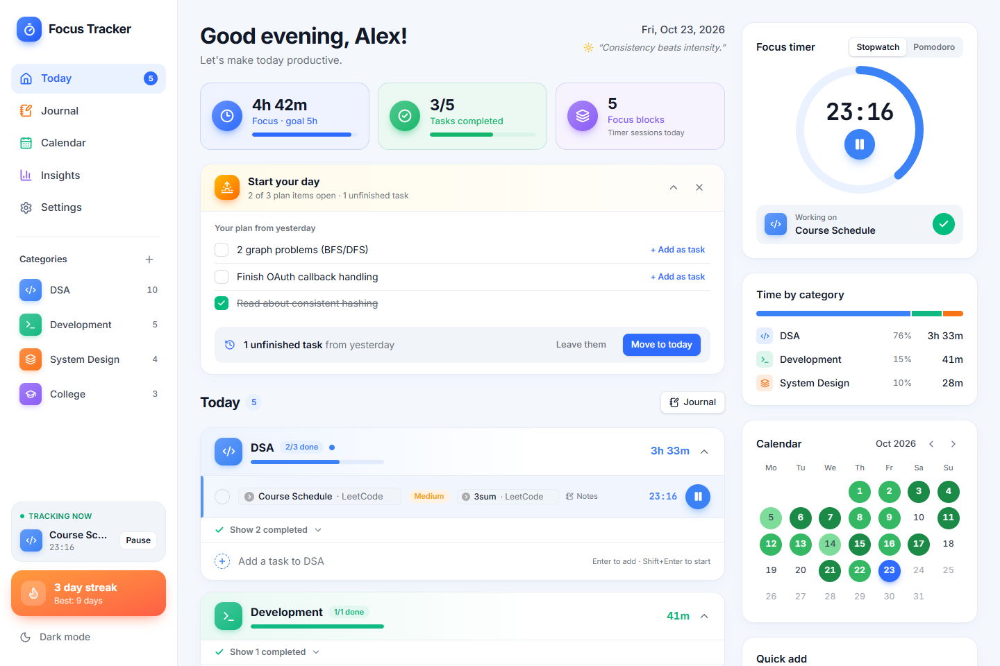
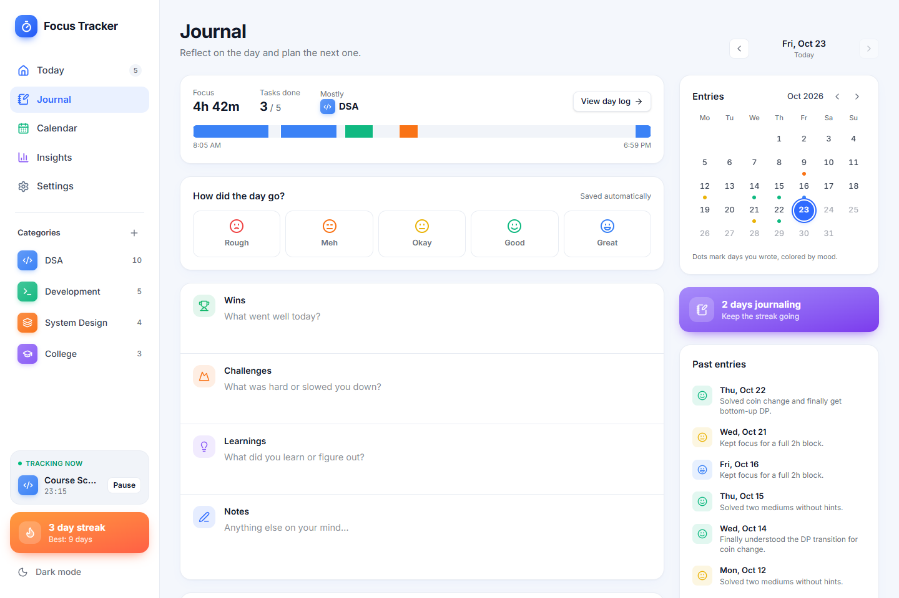
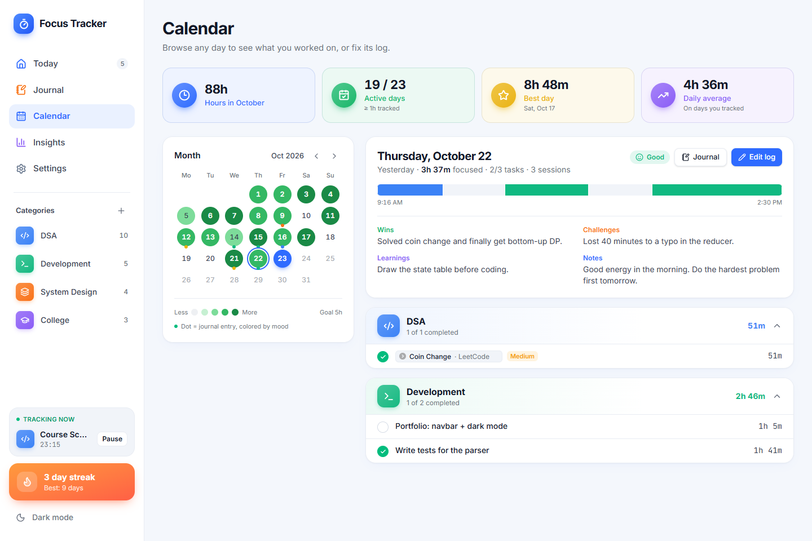
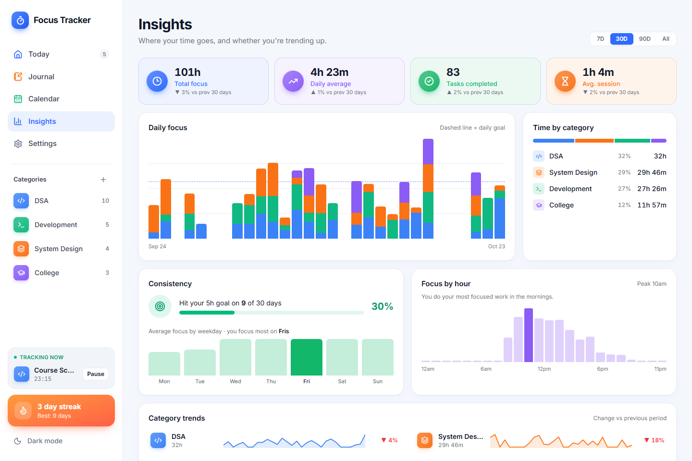
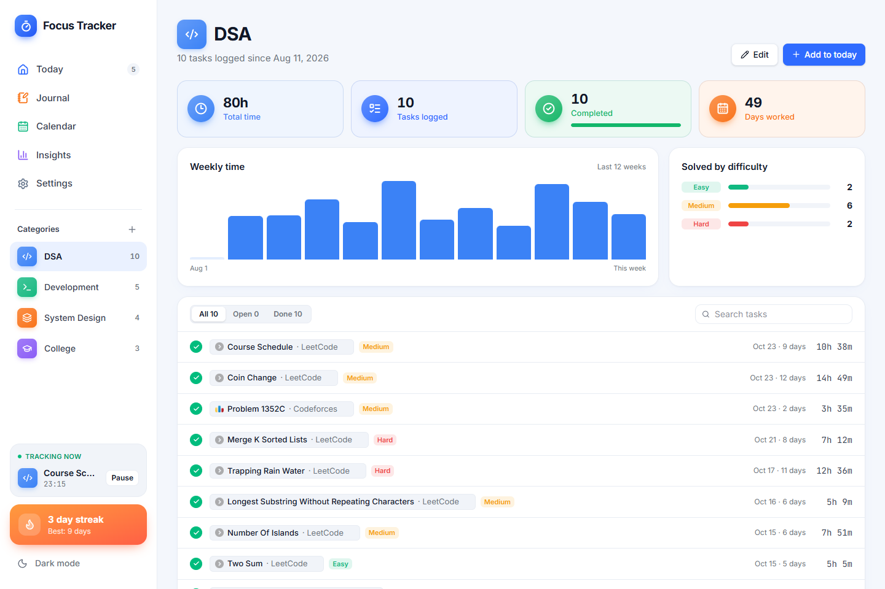
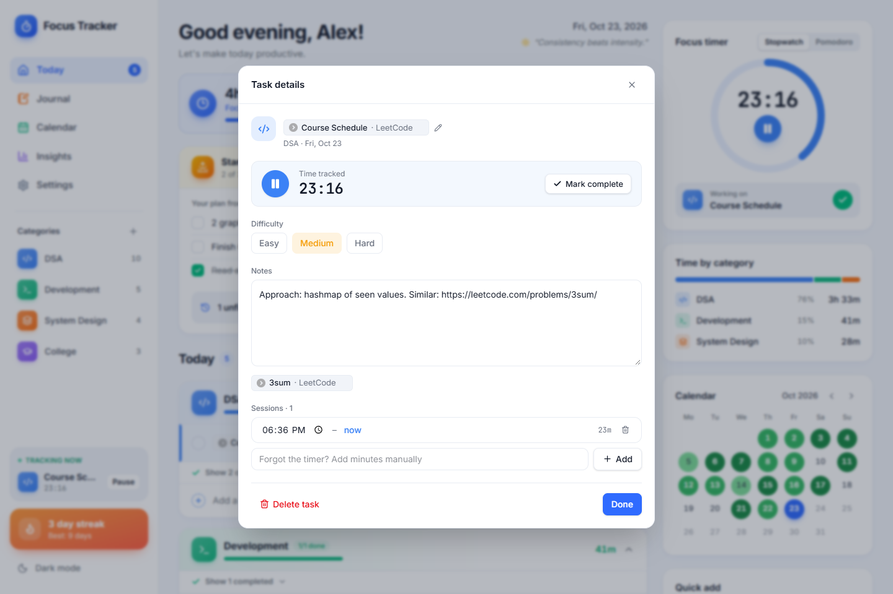
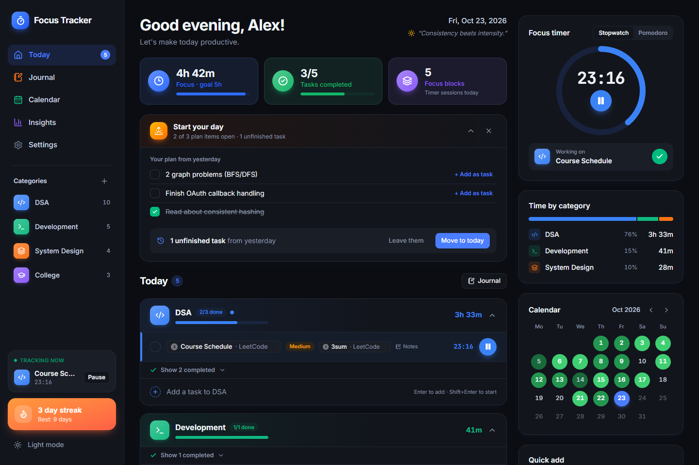
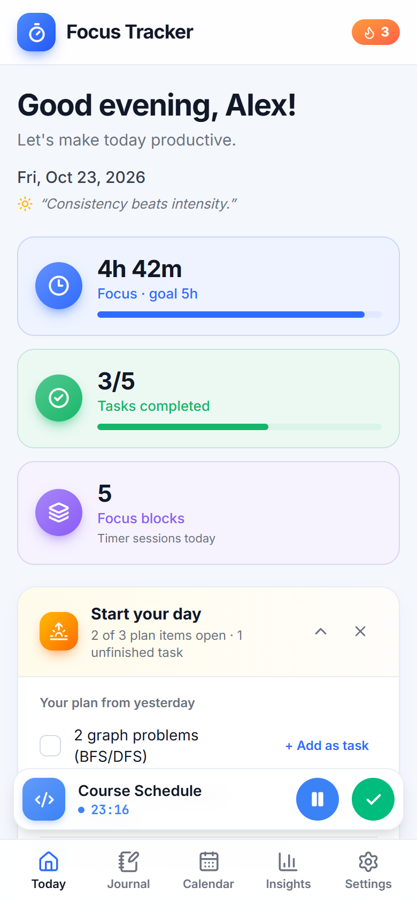

<div align="center">


# Focus Tracker

**Time your tasks, journal your day, and watch your streaks grow.**

A colorful, local-first focus tracker for people grinding through DSA, side projects and coursework.<br/>
Write down what you're working on, press play, and let it keep the score.

[**Live demo →**](https://focus-tracker-lemon.vercel.app)

[](https://github.com/somcpp/focus-tracker/actions/workflows/ci.yml)
[](LICENSE)
[](https://nextjs.org)
[](https://www.typescriptlang.org)
[](https://tailwindcss.com)
[](CONTRIBUTING.md)



</div>

## Why

Todo apps tell you what you planned. Time trackers tell you how long things took. Neither tells you **what you actually did today, in what order, and whether you're getting more consistent**.

Focus Tracker is built around one loop:

1. **Write it down.** Add a task under a category (DSA, Dev, College…). Paste a problem link and it becomes a tidy chip.
2. **Press play.** One timer runs at a time; switching tasks pauses the last one. Pause when you step away.
3. **Reflect.** At the end of the day, journal what went well, what was hard, and plan tomorrow.
4. **See the pattern.** Streaks, a heatmap calendar and insights show whether you're improving.

## Features

### Track
- **Category → task → session** structure; each play/pause creates a session, so totals are always exact
- **One running timer**, live totals per task, category and day, plus a daily goal ring
- **Paste a link, get a chip.** `leetcode.com/problems/two-sum` shows as **Two Sum · LeetCode** with the site's icon (LeetCode, Codeforces, GFG, HackerRank, CodeChef, AtCoder, CSES, GitHub, YouTube and more)
- **Task details**: notes, difficulty (easy / medium / hard), editable sessions, add forgotten minutes manually
- **Start your day**: yesterday's plan and unfinished tasks in one card; turn plan items into tasks in a click
- **Stopwatch or Pomodoro**, an idle check when a timer runs suspiciously long, `Space` to pause / resume

### Reflect
- **Journal** with mood, *Wins*, *Challenges*, *Learnings* and free notes
- **Plan for tomorrow** as a checklist that shows up on the next day's Today page
- **Journaling streak** and a calendar of past entries colored by mood

### Understand
- **Calendar heatmap**: greener days mean more focus; pick any day for its full log, timeline and journal
- **Insights**: trends vs the previous period, goal hit rate, best weekday, focus by hour, per-category sparklines, where your time went
- **Category pages**: every problem you've logged in a category, searchable, with time spent and difficulty split

### Everything else
- Light & dark themes, responsive layout with a mobile timer bar
- **Local-first**: no account, no server, works offline; JSON export / import for backups
- Asks the browser for persistent storage so data isn't evicted

## Screenshots

| Journal | Calendar |
| :---: | :---: |
|  |  |
| **Insights** | **Category page** |
|  |  |
| **Task details** | **Dark mode** |
|  |  |

<p align="center">
  
</p>

## Getting started

**Requirements:** Node.js 20.9+ and npm.

```bash
git clone https://github.com/somcpp/focus-tracker.git
cd focus-tracker
npm install
npm run dev
```

Open [http://localhost:3000](http://localhost:3000). That's it: there's no database or environment variables to set up.

### Scripts

| Command | What it does |
| --- | --- |
| `npm run dev` | Start the dev server |
| `npm run build` | Production build |
| `npm start` | Serve the production build |
| `npm run lint` | ESLint |
| `npm run typecheck` | TypeScript, no emit |
| `npm run screenshots` | Regenerate `docs/screenshots/` with demo data (needs a running production server and Chrome or Edge installed) |

## How it works

All state lives in a single [Zustand](https://zustand.docs.pmnd.rs) store persisted to `localStorage`. Pages render client-side only, so the server never needs your data.

```
Category ─┬─ Task (one per day it appears on) ─┬─ Session { start, end | null }
          │                                     └─ ...
          └─ ...
Journal (per day) ── mood, wins, challenges, learnings, notes, plan[]
```

- A **running timer** is simply a session whose `end` is `null`; elapsed time is computed from timestamps, so it survives reloads and closed tabs.
- **Day totals** are derived from sessions on read; nothing is double-counted or cached.
- The store is **versioned** (`version` in `src/lib/store.ts`) with migrations, so older saved data upgrades automatically.

### Project structure

```
src/
  app/                 # Routes (App Router): Today, journal, calendar, stats, settings, categories/[id]
  components/          # UI: DayBoard, TaskDetail, JournalView, FocusTimer, MiniCalendar, ...
  lib/
    store.ts           # Zustand store, actions, persistence & migrations
    selectors.ts       # Derived data: totals, streaks, grouping
    links.ts           # URL → readable link chip names
    types.ts           # Data model
scripts/               # Demo data + screenshot generator
docs/screenshots/      # Images used in this README
```

## Data & privacy

Your data never leaves your browser. The only network requests are for fonts and the small favicons shown on link chips. Clearing site data deletes everything, so use **Settings → Export backup** regularly; Settings shows when you last did.

## Roadmap

- [ ] Accounts + cloud sync (local-first, so it keeps working offline)
- [ ] Search across tasks, notes and journal (`Ctrl+K`)
- [ ] Installable PWA
- [ ] Drag to reorder tasks

Have an idea? [Open an issue](https://github.com/somcpp/focus-tracker/issues/new/choose).

## Contributing

Contributions are welcome, from typo fixes to new features. Please read [CONTRIBUTING.md](CONTRIBUTING.md) for setup, conventions and how to open a pull request, and follow the [Code of Conduct](CODE_OF_CONDUCT.md).

## License

[MIT](LICENSE) © Saubhagya Sharma
